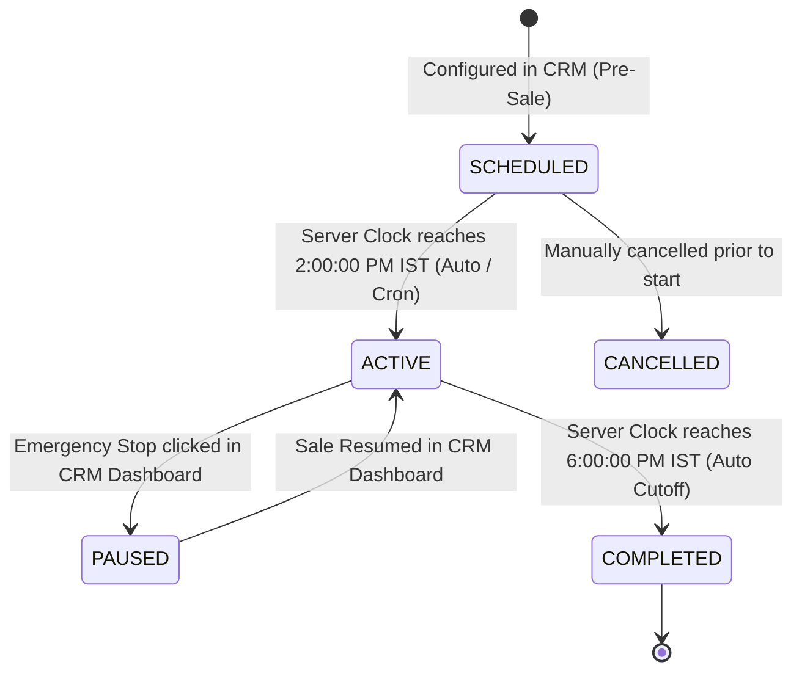

# Swastik Jewels — Scheduled 30% Diamond Sale (6 Nov 2026, 2:00 PM – 6:00 PM IST)
## CRM Developer Technical Handoff & Server-Authoritative Checkout Enforcement Specification

**Document Version**: 2.0.0 (Updated for CRM-Managed Programmatic Discount Enforcement)  
**Target Developer**: Swastik Jewels CRM & Backend Engineering Team  
**Scope Boundary**: Backend Services, Database, Shopify Admin GraphQL API, Paytm Payment Gateway, Webhooks, and Checkout Total Enforcement.  
*(Storefront UI, promotional price display, badges, reference notices, and pre-sale warning acknowledgement modals are implemented in the Shopify theme `Login-opt`).*

---

## 1. Executive Summary & Architectural Scope

### 1.1 Objective & Core Business Requirement
The business requirement is:
> **The CRM/backend must control the diamond sale schedule, eligibility rules, and discount percentage without requiring store staff to manually create, schedule, enable, or disable a Shopify Automatic Discount in Shopify Admin.**

This handoff provides the CRM/backend developer with a complete, actionable engineering blueprint to achieve this.

### 1.2 Preservation of Existing Frontend Theme Implementation
The Shopify storefront theme already has full frontend support implemented and verified:
- **Promotional Display**: Displays the 30% discounted price with the original price struck through in [`sections/product.liquid`](file:///d:/swastik%20shopify%20R/Login-opt/sections/product.liquid).
- **Badge**: Displays the luxury emerald-and-gold `"30% OFF ON DIAMONDS"` badge.
- **Pre-Sale Reference Notice**: Informs customers prior to 2:00 PM IST that the discounted price is an upcoming promotional reference price, not the currently payable price.
- **Pre-Sale Acknowledgement Modal**: Intercepts PDP "Buy Now", Cart Page "Proceed to Checkout", and Cart Drawer checkout with a mandatory **unchecked acknowledgement checkbox** required before continuing.
- **Clock Synchronization**: Synchronizes server time using origin HTTP `HEAD` Date headers in `Asia/Kolkata` (`UTC+05:30`).
- **Post-Sale Automatic Restoration**: Automatically hides promotional pricing and restores normal prices after 6:00 PM IST.
- **Paytm Payment Gateway**: Seamlessly preserved; no Razorpay integration is introduced.

The theme controller in [`snippets/diamond-sale-logic.liquid`](file:///d:/swastik%20shopify%20R/Login-opt/snippets/diamond-sale-logic.liquid) now queries the CRM status endpoint `GET /api/diamond-sale/status` to determine live server status and checkout discount availability.

### 1.3 Verified Facts vs. Unverified Backend Assumptions

| Aspect | Status | Source / Verification |
| :--- | :---: | :--- |
| **Theme Code & Layout** | **VERIFIED** | Inspected and tested in `d:\swastik shopify R\Login-opt`. |
| **Theme Diamond Detection** | **VERIFIED** | Tags (`diamond`, `natural-diamond`, `lab-grown`), collection handles, title, and metafields. |
| **Theme Pre-Sale Interceptor** | **VERIFIED** | Modal with unchecked checkbox wired to Buy Now & Checkout triggers. |
| **Payment Gateway** | **VERIFIED** | Paytm is the existing payment gateway. Razorpay is strictly prohibited. |
| **CRM Backend Source Code** | **UNVERIFIED** | Backend code resides outside this repository (hosted at `backend-api.swastikjewel.in`). |
| **Shopify Admin API Token Scopes** | **UNVERIFIED** | Must be verified in Shopify Admin by the CRM developer to ensure `write_discounts` is enabled. |
| **CRM Database Engine** | **UNVERIFIED** | Assumed PostgreSQL / MySQL / MongoDB in CRM; developer to map proposed schema. |

---

## 2. CRM-Managed Sale Configuration & State Machine

The CRM backend must act as the **single authoritative source of truth** for the sale configuration, rules, and lifecycle state.

### 2.1 Authoritative Schedule & Parameters
- **Event Name**: 30% Diamond Flash Sale
- **Start Timestamp**: `2026-11-06T14:00:00+05:30` (Unix Epoch: `1793953800000` ms / `1793953800` s)
- **End Timestamp**: `2026-11-06T18:00:00+05:30` (Unix Epoch: `1793968200000` ms / `1793968200` s)
- **Timezone**: `Asia/Kolkata` (UTC+05:30)
- **Discount Percentage**: `30%` (Fixed for this event; configurable in CRM)
- **Rounding Rule**: Standard mathematical rounding to 2 decimal places (or nearest rupee). Formula:
  $$\text{Discount} = \text{Round}\left(\frac{\text{OriginalPrice} \times 30}{100}, 2\right)$$
  $$\text{PayablePrice} = \text{OriginalPrice} - \text{Discount}$$
- **Discount Stacking Rule**: By default, the 30% Diamond Sale discount **CANNOT** be combined with standard coupon codes (e.g. `WELCOME10`) or order-level voucher codes unless explicitly enabled by a flag in the CRM config (`allow_coupon_stacking: false`).

### 2.2 CRM Database Schema (Proposed)

#### Table / Collection: `diamond_sale_configs`
```sql
CREATE TABLE diamond_sale_configs (
    id VARCHAR(64) PRIMARY KEY, -- e.g. "dia_sale_20261106"
    title VARCHAR(255) NOT NULL, -- "30% Diamond Flash Sale"
    discount_percent NUMERIC(5,2) NOT NULL DEFAULT 30.00,
    start_time_iso TIMESTAMP WITH TIME ZONE NOT NULL, -- 2026-11-06 14:00:00+05:30
    end_time_iso TIMESTAMP WITH TIME ZONE NOT NULL,   -- 2026-11-06 18:00:00+05:30
    timezone VARCHAR(50) NOT NULL DEFAULT 'Asia/Kolkata',
    status VARCHAR(30) NOT NULL DEFAULT 'SCHEDULED', -- SCHEDULED, ACTIVE, PAUSED, COMPLETED, CANCELLED
    eligible_tags TEXT[], -- ['diamond', 'natural-diamond', 'lab-grown', 'diamond-sale']
    eligible_collection_handles TEXT[], -- ['natural-diamonds', 'lab-grown-diamonds']
    allow_coupon_stacking BOOLEAN NOT NULL DEFAULT FALSE,
    shopify_discount_id VARCHAR(100), -- GID returned by Shopify Admin API: "gid://shopify/DiscountAutomaticNode/..."
    created_at TIMESTAMP WITH TIME ZONE DEFAULT NOW(),
    updated_at TIMESTAMP WITH TIME ZONE DEFAULT NOW(),
    updated_by VARCHAR(100)
);
```

#### Table / Collection: `diamond_sale_audit_logs`
```sql
CREATE TABLE diamond_sale_audit_logs (
    id SERIAL PRIMARY KEY,
    sale_config_id VARCHAR(64) REFERENCES diamond_sale_configs(id),
    action VARCHAR(50) NOT NULL, -- 'CREATED', 'SCHEDULE_UPDATED', 'PAUSED', 'ACTIVATED', 'EXPIRED'
    performed_by VARCHAR(100) NOT NULL,
    old_values JSONB,
    new_values JSONB,
    timestamp TIMESTAMP WITH TIME ZONE DEFAULT NOW()
);
```

### 2.3 CRM State Machine Lifecycle



- **SCHEDULED**: Time is before `2026-11-06T14:00:00+05:30`.
  - Storefront shows promotional reference price with warning modal.
  - Checkout charges original regular price.
- **ACTIVE**: Time is between `14:00:00` and `18:00:00` IST and `status == 'ACTIVE'`.
  - Shopify discount mechanism is active.
  - Real 30% discount applied to eligible diamond items at checkout.
- **PAUSED**: Merchant paused sale from CRM dashboard.
  - Discount is immediately deactivated programmatically via Shopify API.
  - Storefront updates within 10 seconds via status sync.
- **COMPLETED**: Time has reached `18:00:00` IST.
  - Discount is immediately terminated programmatically or by Shopify timestamp expiry.
  - Normal prices restored. Stale checkout attempts rejected.

---

## 3. Actual Checkout Discount Enforcement Architecture

### 3.1 The Platform Constraint
In Shopify, an external backend cannot send an HTTP POST to an open `/checkout` session to alter the subtotal. The price must be computed by Shopify's checkout engine.

To meet the requirement that **no one manually creates a Shopify Automatic Discount**, the CRM must enforce the price using one of two official, programmatic Shopify integration mechanisms:

---

### 3.2 Primary Mechanism: Programmatic Shopify Admin GraphQL Discount Lifecycle API (Recommended)

#### How It Works:
Instead of a human logging into Shopify Admin, the **CRM backend programmatically creates, schedules, monitors, and deactivates the native Shopify Automatic Discount** via the Shopify Admin GraphQL API.

1. **One-Time Requirement**: The CRM backend holds a Shopify Custom App API access token with the `write_discounts` and `read_discounts` scopes.
2. **Automated Lifecycle Flow**:
   - **Pre-Sale Phase (Scheduling)**:
     The CRM backend calls `discountAutomaticBasicCreate` via GraphQL. It sets the exact start and end timestamps in UTC (`2026-11-06T08:30:00Z` to `2026-11-06T12:30:00Z`), targets eligible collections/tags, and specifies `percentage: 0.30`.
   - **Active Window (Execution)**:
     Shopify's native checkout engine enforces the 30% discount automatically for any eligible cart. No discount code entry is required from the customer.
   - **Post-Sale Phase (Automated Cutoff)**:
     Because the discount has an authoritative `endsAt` timestamp, Shopify's checkout engine automatically ceases applying the discount at `12:30:00 UTC` (6:00:00 PM IST). Even if a customer opened checkout at 5:58 PM, finalizing payment after 6:00 PM will fail the discount evaluation and recalculate at original price.
   - **Real-Time CRM Control**:
     If the CRM administrator clicks "Pause Sale" or "Change to 35%" in the CRM dashboard, the CRM backend calls `discountAutomaticDeactivate` or `discountAutomaticBasicUpdate` in real time.

#### Exact GraphQL Mutation: Create Programmatic Automatic Discount
```graphql
mutation CreateProgrammaticDiamondDiscount($automaticBasicDiscount: DiscountAutomaticBasicInput!) {
  discountAutomaticBasicCreate(automaticBasicDiscount: $automaticBasicDiscount) {
    automaticDiscountNode {
      id
      automaticDiscount {
        ... on DiscountAutomaticBasic {
          title
          status
          startsAt
          endsAt
          customerGets {
            value {
              ... on DiscountPercentage {
                percentage
              }
            }
            items {
              ... on DiscountCollections {
                collections(first: 5) {
                  nodes {
                    id
                    handle
                  }
                }
              }
            }
          }
        }
      }
    }
    userErrors {
      field
      code
      message
    }
  }
}
```

#### Mutation Variables (sent by CRM backend):
```json
{
  "automaticBasicDiscount": {
    "title": "30% Diamond Flash Sale [CRM-Managed]",
    "startsAt": "2026-11-06T08:30:00Z",
    "endsAt": "2026-11-06T12:30:00Z",
    "customerGets": {
      "value": {
        "percentage": 0.30
      },
      "items": {
        "collections": {
          "add": [
            "gid://shopify/Collection/462910482934",
            "gid://shopify/Collection/462910515702"
          ]
        }
      }
    },
    "combinesWith": {
      "orderDiscounts": false,
      "productDiscounts": false,
      "shippingDiscounts": true
    }
  }
}
```

#### Programmatic Deactivation (For Emergency Pause / Early Termination):
```graphql
mutation DeactivateDiamondDiscount($id: ID!) {
  discountAutomaticDeactivate(id: $id) {
    automaticDiscountNode {
      id
      automaticDiscount {
        ... on DiscountAutomaticBasic {
          status
        }
      }
    }
    userErrors {
      field
      message
    }
  }
}
```

---

### 3.3 Alternative Mechanism: Shopify Functions (Discount API - `product_discount`) Driven by CRM Metafields

If Swastik Jewels operates on a Shopify Plus or compatible architecture utilizing Shopify Functions:
1. **How It Works**: A lightweight WebAssembly Function extension (`type: product_discount`) is deployed once to Shopify.
2. **Dynamic Configuration via Metafields**:
   The Function does not contain hardcoded times. Instead, its input query reads:
   `shop.metafields.swastik_crm.diamond_sale_config`
3. **CRM Management**:
   The CRM backend writes to this metafield using the standard Shopify Admin API:
   `mutation metafieldsSet($metafields: [MetafieldsSetInput!]!)`
   Whenever the CRM admin updates the schedule, discount percentage, or pauses the sale, the CRM updates the metafield.
4. **Execution**:
   During checkout, Shopify executes the Function in WebAssembly (< 5ms). The function checks `Date.now() >= start && Date.now() < end`. If valid, it returns line-item discounts for eligible diamond variants.
5. **Advantage**: Zero Shopify Admin discount records created. 100% metadata-driven.

---

### 3.4 Custom Order / Pre-Reservation Mechanism: Shopify Draft Orders API
For customers with Dhanteras ₹1,000 reservation tokens or CRM VIP purchase links:
- Route: `POST /admin/api/2024-01/draft_orders.json`
- The CRM backend computes the exact balance:
  $$\text{Balance} = \text{OriginalPrice} - (\text{OriginalPrice} \times 0.30) - 1000$$
- Creates a Draft Order with `applied_discount` and returns `invoice_url`.
- The customer is redirected directly into Paytm payment checkout with the server-locked total.

---

## 4. Dedicated Shopify Admin Dependency Report

| # | Question | Direct Answer | Technical Rationale & Specifications |
| :---: | :--- | :---: | :--- |
| **1** | **Can the sale schedule and percentage be fully managed from CRM?** | **YES** | The CRM database stores the authoritative schedule, status, and discount percentage, operating as the system of record. |
| **2** | **Can actual discounts be applied at Shopify checkout without manually creating a scheduled Automatic Discount?** | **YES** | By using the **Shopify Admin GraphQL Discount Lifecycle API** (`discountAutomaticBasicCreate`) or **Shopify Functions**, the CRM server initiates and manages the discount programmatically. No human needs to log into Shopify Admin. |
| **3** | **What Shopify-supported mechanism is required to make that work?** | **Programmatic Admin API** | **Option A**: Programmatic creation of an Automatic Discount via Shopify Admin GraphQL API using Custom App credentials. <br>**Option B**: Shopify Function (Product Discount API) driven by CRM-updated shop metafields. |
| **4** | **Is any one-time Shopify app/extension installation, permission, deployment, or configuration required?** | **YES (One-time setup)** | **Mandatory One-Time Setup**:<br>1. Create a Custom App in Shopify Admin (Settings -> Apps -> Develop apps).<br>2. Grant Admin API Scopes: `write_discounts`, `read_discounts`, `write_products`, `read_products`, `read_orders`, `write_draft_orders`.<br>3. Generate `SHOPIFY_ADMIN_API_TOKEN` and provide to CRM backend.<br>4. (If using Functions): One-time deploy via Shopify CLI. |
| **5** | **Which recurring tasks, if any, would still require manual Shopify Admin actions?** | **ZERO** | None. All recurring actions (scheduling, activation, percentage changes, pause/resume, post-sale cutoff) are executed via backend API calls or automated expiry timestamps. |
| **6** | **What happens if the required discount integration is unavailable when the sale starts?** | **Fail-Safe Degradation** | 1. The storefront checks `GET /api/diamond-sale/status`. If `checkout_discount_active: false`, it displays: *"30% Diamond Sale is active. Checkout discount is being finalized."* without claiming false payable amounts.<br>2. Orders default safely to regular price (no revenue under-collection).<br>3. CRM pre-flight check at 1:30 PM IST alerts engineering if API authentication fails. |

---

## 5. Inspection of Existing CRM and Shopify Order Flow

### 5.1 Verified Infrastructure (In Repository)
- **Storefront Theme**: Shopify Liquid theme `Login-opt`.
- **Cart & Buy Now Actions**:
  - PDP Buy Now (`.pp-btn-buy`) submits form directly to `/checkout` (or AJAX cart add followed by `/checkout`).
  - Cart Page checkout (`#cart-proceed-checkout-btn`) calls `window.handleProceedToCheckout()`.
  - Cart Drawer checkout (`#cart-drawer-form`) posts to `{{ routes.cart_url }}` with submitter `checkout`.
- **Payment Gateway**: Paytm Payment Gateway (configured in Shopify Admin Payment Settings).
- **Existing Booking API**: `POST https://backend-api.swastikjewel.in/api/dhanteras/create-booking-order` (documented in [`DHANTERAS_CRM_DEVELOPER_HANDOFF.md`](file:///d:/swastik%20shopify%20R/Login-opt/docs/DHANTERAS_CRM_DEVELOPER_HANDOFF.md)).
- **Existing Callback Route**: `/api/dhanteras/paytm-callback`.

### 5.2 Unverified Backend Behavior (CRM Developer Must Inspect)
The CRM developer must inspect their backend application codebase to confirm:
1. **Existing Shopify Admin Client**: Does the CRM service already have a configured Shopify REST/GraphQL client library (`@shopify/shopify-api` or Axios instance with `X-Shopify-Access-Token`)?
2. **Existing Scopes**: Verify if the installed Custom App already includes `write_discounts`. If not, update app scopes in Shopify Admin Settings.
3. **Database Migration Capability**: Confirm where the `diamond_sale_configs` and audit log tables should be migrated within the CRM persistence layer.
4. **Task Scheduler / Cron Infrastructure**: Check if the CRM has an active job scheduler (BullMQ, Celery, Agenda, or AWS EventBridge) to trigger the 1:30 PM pre-flight test and status checks.

---

## 6. Complete API Contracts for the CRM Developer

### Endpoint 1: Storefront Authoritative Sale Status & Schedule Check
- **Route**: `GET /api/diamond-sale/status`
- **Method**: `GET`
- **Purpose**: Called by the storefront theme (`diamond-sale-logic.liquid`) on page load and heartbeat to synchronize server atomic time, current phase, and checkout discount readiness.
- **Authentication**: Public / Storefront Header (`X-Swastik-Storefront-Token` optional).
- **Request Headers**:
  `Accept: application/json`

#### Response (HTTP 200 OK — Pre-Sale Phase):
```json
{
  "status": "success",
  "data": {
    "sale_id": "dia_sale_20261106",
    "event_name": "30% Diamond Flash Sale",
    "current_phase": "pre-sale",
    "server_time_iso": "2026-10-20T13:56:00+05:30",
    "server_time_unix": 1792484760000,
    "timezone": "Asia/Kolkata",
    "sale_window": {
      "start_iso": "2026-11-06T14:00:00+05:30",
      "end_iso": "2026-11-06T18:00:00+05:30",
      "start_unix": 1793953800000,
      "end_unix": 1793968200000,
      "duration_hours": 4
    },
    "discount_percent": 30,
    "checkout_discount_active": false,
    "message": "Upcoming 30% Diamond Sale starts Nov 6 at 2:00 PM IST."
  }
}
```

#### Response (HTTP 200 OK — Active Flash Sale Phase):
```json
{
  "status": "success",
  "data": {
    "sale_id": "dia_sale_20261106",
    "event_name": "30% Diamond Flash Sale",
    "current_phase": "active",
    "server_time_iso": "2026-11-06T14:15:22+05:30",
    "server_time_unix": 1793954722000,
    "timezone": "Asia/Kolkata",
    "sale_window": {
      "start_iso": "2026-11-06T14:00:00+05:30",
      "end_iso": "2026-11-06T18:00:00+05:30",
      "start_unix": 1793953800000,
      "end_unix": 1793968200000
    },
    "discount_percent": 30,
    "checkout_discount_active": true,
    "shopify_discount_id": "gid://shopify/DiscountAutomaticNode/1209384729",
    "message": "30% Diamond Flash Sale is actively running until 6:00 PM IST."
  }
}
```

---

### Endpoint 2: Server-Authoritative Price & Order Calculation
- **Route**: `POST /api/diamond-sale/calculate-order`
- **Method**: `POST`
- **Purpose**: Validates variant eligibility, calculates official line-item discount amounts, checks coupon compatibility, and returns authoritative payable numbers before payment.
- **Authentication**: Storefront session token or customer auth bearer.

#### Request Payload:
```json
{
  "items": [
    {
      "variant_id": "54672144859454",
      "product_id": "12676718625086",
      "quantity": 1,
      "original_unit_price": 91969.00
    }
  ],
  "applied_coupon_code": null,
  "customer": {
    "phone": "+919876543210",
    "email": "customer@example.com"
  }
}
```

#### Server Validation Rules:
1. **Server Clock Check**: Evaluates current atomic server time against `2026-11-06T14:00:00+05:30` and `2026-11-06T18:00:00+05:30`.
2. **Database Verification**: Verifies `variant_id` against trusted Shopify product cache in CRM.
3. **Diamond Eligibility**: Checks if the item has diamond tags, belongs to diamond collections, or has `diamond_value > 0`.
4. **Anti-Tampering**: Rejects any client-passed `discount_amount` or `discounted_price`. All discounts are computed on the server.

#### Response (HTTP 200 OK — Pre-Sale: No Discount Allowed):
```json
{
  "status": "success",
  "phase": "pre-sale",
  "currency": "INR",
  "summary": {
    "subtotal_original": 91969.00,
    "sale_discount_amount": 0.00,
    "final_payable_amount": 91969.00,
    "promotional_reference_sale_price": 64378.30
  },
  "line_items": [
    {
      "variant_id": "54672144859454",
      "is_diamond_eligible": true,
      "original_price": 91969.00,
      "applied_sale_discount": 0.00,
      "payable_price": 91969.00,
      "reason": "Sale starts Nov 6 at 2:00 PM IST. Pre-sale orders require regular price."
    }
  ]
}
```

#### Response (HTTP 200 OK — Active Sale: 30% Discount Applied):
```json
{
  "status": "success",
  "phase": "active",
  "currency": "INR",
  "summary": {
    "subtotal_original": 91969.00,
    "sale_discount_amount": 27590.70,
    "final_payable_amount": 64378.30
  },
  "line_items": [
    {
      "variant_id": "54672144859454",
      "is_diamond_eligible": true,
      "original_price": 91969.00,
      "applied_sale_discount": 27590.70,
      "payable_price": 64378.30,
      "discount_title": "30% Diamond Flash Sale"
    }
  ]
}
```

---

### Endpoint 3: Create Server-Locked Checkout / Draft Order
- **Route**: `POST /api/diamond-sale/create-checkout`
- **Method**: `POST`
- **Purpose**: Generates a server-locked Shopify Draft Order and initiates a Paytm PG transaction for the exact calculated payable balance.
- **Request Headers**:
  `Idempotency-Key: <unique-uuid-generated-by-client>`

#### Request Payload:
```json
{
  "variant_id": "54672144859454",
  "quantity": 1,
  "customer_name": "Priya Sharma",
  "customer_phone": "+919876543210",
  "customer_email": "priya@example.com",
  "shipping_address": {
    "address1": "124 Golf Links",
    "city": "New Delhi",
    "province": "Delhi",
    "zip": "110003",
    "country": "India"
  }
}
```

#### Backend Execution Flow:
1. Validates `Idempotency-Key` in Redis/DB to prevent duplicate order generation.
2. Checks server time:
   - If `now < 14:00 IST`: Generates Draft Order at regular price (₹91,969.00).
   - If `now >= 14:00 && now < 18:00 IST`: Generates Draft Order with 30% discount (₹64,378.30).
   - If `now >= 18:00 IST`: Rejects request with `403 Forbidden` (`SALE_EXPIRED`).
3. Calls Shopify Admin API (`POST /admin/api/2024-01/draft_orders.json`).
4. Initiates Paytm Transaction via Paytm API (`/theia/api/v1/initiateTransaction`).

#### Response (HTTP 200 OK):
```json
{
  "status": "success",
  "order_id": "SW-DIA-20261106-90412",
  "draft_order_id": 1092837465,
  "payable_amount": 64378.30,
  "gateway": "paytm",
  "checkout_url": "https://securegw.paytm.in/theia/api/v1/showPaymentPage?mid=SWASTIK_MID&orderId=SW-DIA-20261106-90412&txnToken=PAYTM_TXN_TOKEN"
}
```

---

### Endpoint 4: Paytm Callback & Checksum Verification (Existing Integration)
- **Route**: `/api/diamond-sale/paytm-callback` (or `/api/dhanteras/paytm-callback`)
- **Method**: `POST` (Form encoded payload from Paytm)
- **Purpose**: Receives transaction response, cryptographically verifies checksum signature, checks order timestamps, completes Shopify order, and redirects customer.

#### Processing Steps:
1. **Signature Verification**:
   ```javascript
   const PaytmChecksum = require('paytmchecksum');
   const paytmParams = req.body;
   const paytmChecksum = paytmParams.CHECKSUMHASH;
   delete paytmParams.CHECKSUMHASH;

   const isValidSignature = PaytmChecksum.verifySignatureByString(
     JSON.stringify(paytmParams),
     process.env.PAYTM_MERCHANT_KEY,
     paytmChecksum
   );
   if (!isValidSignature) {
     return res.status(400).send("Invalid Paytm Signature");
   }
   ```
2. **Transaction Status Check**:
   If `paytmParams.STATUS === 'TXN_SUCCESS'` and `paytmParams.RESPCODE === '01'`:
   - Complete Shopify Draft Order via Shopify Admin API (`PUT /admin/api/2024-01/draft_orders/{id}/complete.json`).
   - Store transaction details: `paytm_txn_id`, `bank_txn_id`, `paid_at`, `sale_price`.
   - Redirect customer to order confirmation page.
3. **Failure Handling**:
   If payment fails, release holds and redirect customer to checkout retry with failure reason.

---

### Endpoint 5: Shopify Order Paid Webhook
- **Route**: `POST /api/diamond-sale/shopify-order-webhook`
- **Method**: `POST`
- **Trigger**: Shopify Webhook `orders/paid` or `orders/create`
- **Purpose**: Verifies that orders completed through standard Shopify Checkout during the sale window are logged into the CRM ledger with correct promotional tracking tags.

---

## 7. Security, Anti-Tampering & Stale Cart Rules

1. **Client Price Zero-Trust**:
   Under no circumstances should the CRM accept `price`, `discount_amount`, or `total` sent from the browser. All financial figures must be re-calculated server-side using variant prices stored in the CRM database or verified via the Shopify Admin API.
2. **No Secret Exposure**:
   Never expose Shopify Admin API access tokens (`shpat_...`), Paytm Merchant Keys, or backend service secrets in Shopify Liquid templates or JavaScript assets.
3. **Strict Time Cutoff at 6:00:00 PM IST**:
   - The CRM must never validate or complete a discounted order submitted at `18:00:01` IST or later.
   - If a customer initiates a transaction at 5:59 PM but the Paytm callback completes at 6:05 PM, the CRM must verify whether the payment initiation token was created before 6:00 PM.
   - Any new checkout attempts created at or after 6:00 PM IST must strictly use regular prices.
4. **Test Simulation Separation**:
   The theme’s developer simulation methods (`window.DiamondSale.setTestPhase(...)` and `?diamond_sale_test_phase=...`) are strictly client-side DOM helpers for UX validation. The backend API must completely ignore these parameters and compute pricing using real atomic server time.

---

## 8. Comprehensive 12-Point QA Testing Matrix

| Test Case | Simulated Time | Cart Configuration | Expected Storefront Display | Expected Checkout / Order Payable Amount | Pass Criteria |
| :---: | :---: | :--- | :--- | :--- | :---: |
| **TC-01** | Before 2:00 PM IST | 1 Diamond Nath (₹91,969.00) | ₹64,378.30 promo, ₹91,969 struck, badge, pre-sale reference notice. | ₹91,969.00 (Full Original Price). | Modal requires unchecked acknowledgement; order charged at full price. |
| **TC-02** | Exactly 2:00:00 PM IST | 1 Diamond Nath | Automatically transitions to `FLASH SALE LIVE`. | ₹64,378.30 (30% Discount applied). | Programmatic discount activates; no warning modal. |
| **TC-03** | 3:30 PM IST (Active) | 1 Diamond Nath + 1 Diamond Bracelet | Both items show 30% off with live badges. | Both items receive 30% discount at checkout. | Correct payable subtotal; Paytm PG reflects discounted amount. |
| **TC-04** | 4:00 PM IST (Active) | 1 Diamond Nath + 1 Plain Gold Coin (Ineligible) | Diamond item shows 30% badge; Gold coin shows regular price. | 30% discount applied ONLY to Diamond item; Gold coin at full price. | Non-diamond product is not discounted. |
| **TC-05** | 4:30 PM IST (Active) | Variant change from 14K to 18K Gold | Price updates to 18K price; 30% discount recalculates dynamically. | 30% discount matches selected 18K variant price. | Variant change price sync verified. |
| **TC-06** | 4:45 PM IST (Active) | Diamond Nath + Customer attempts coupon code | Displays sale discount. Stacking rule evaluated. | Standard coupon rejected or stacked per CRM policy. | No unauthorized double-discounting. |
| **TC-07** | Exactly 6:00:00 PM IST | 1 Diamond Nath | Automatically restores normal price; badge & notice hidden. | ₹91,969.00 (Full Original Price). | Discount terminates immediately. |
| **TC-08** | Stale Cart (Opened 5:58 PM, Submitted 6:02 PM) | 1 Diamond Nath | Storefront restores normal price upon page refresh. | Checkout rejects 30% discount; prompts customer to pay regular price. | Sale window hard cutoff strictly enforced. |
| **TC-09** | Any Phase | Customer modifies device clock / query param | Displays UI per test param. | Server completely ignores client param; charges according to server atomic clock. | Client-side tampering impossible. |
| **TC-10** | Any Phase | Network / CRM API Outage | Storefront retains graceful Liquid fallback display. | Defaults safely to regular price. | No broken pages; no under-collection. |
| **TC-11** | Any Phase | Duplicate Paytm Callback received | First callback confirms order. | Second duplicate callback is acknowledged idempotently without double-order creation. | Idempotency verified. |
| **TC-12** | Any Phase | Paytm Payment Cancelled / Failed | User redirected to retry page. | Inventory reservation released; status marked `FAILED`. | Clean cancellation handling. |

---

## 9. CRM Developer Actionable Implementation Checklist

- [ ] **Step 1: One-Time Custom App Setup in Shopify Admin**
  - Create Custom App in Shopify Admin (`Apps -> Develop apps`).
  - Enable scopes: `write_discounts`, `read_discounts`, `write_products`, `read_products`, `read_orders`, `write_draft_orders`.
  - Install app and record `SHOPIFY_ADMIN_API_TOKEN` in CRM environment.
- [ ] **Step 2: Database Migration**
  - Run database migration for `diamond_sale_configs` and `diamond_sale_audit_logs`.
  - Insert sale record for `2026-11-06T14:00:00+05:30` to `2026-11-06T18:00:00+05:30` with `30%` discount.
- [ ] **Step 3: Implement Status & Order Calculation Endpoints**
  - Deploy `GET /api/diamond-sale/status`.
  - Deploy `POST /api/diamond-sale/calculate-order`.
- [ ] **Step 4: Implement Programmatic Shopify Discount Lifecycle Client**
  - Build service method calling `discountAutomaticBasicCreate` with schedule `2026-11-06T08:30:00Z` to `2026-11-06T12:30:00Z`.
  - Build emergency pause/resume methods calling `discountAutomaticDeactivate` / `discountAutomaticActivate`.
- [ ] **Step 5: Verify Paytm PG & Webhook Handling**
  - Confirm `/paytm-callback` verifies `CHECKSUMHASH` using `paytmchecksum`.
  - Connect `orders/paid` webhook listener.
- [ ] **Step 6: Pre-Flight Test at 1:30 PM IST (Nov 6, 2026)**
  - Automated worker executes pre-flight sanity test 30 minutes before sale.
  - Verifies Shopify Admin API authentication and Paytm gateway connectivity.
